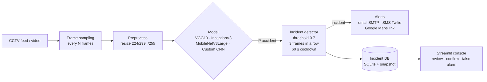
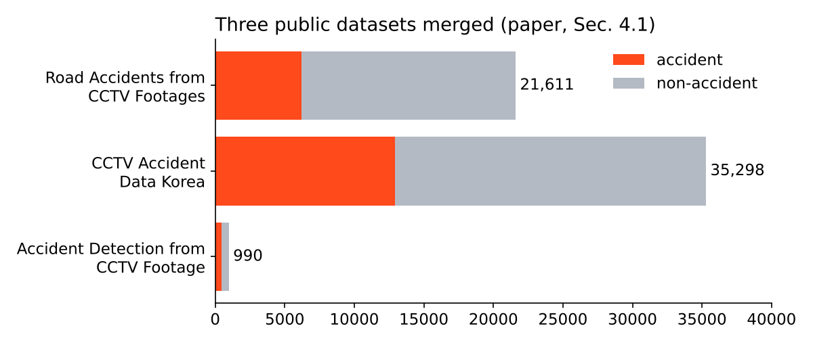
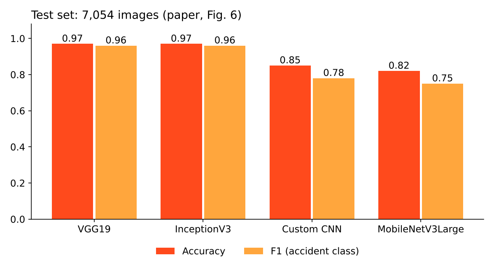
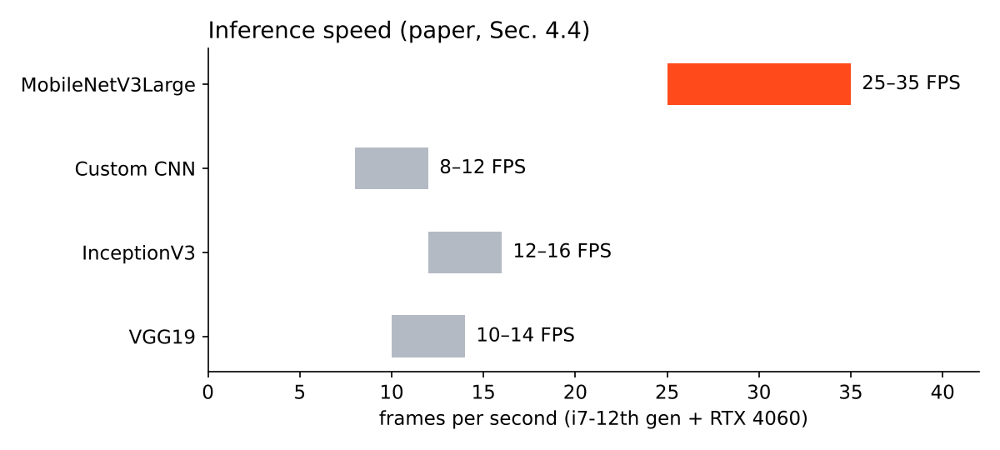

# Traffic Collision Detection & Automated Reporting (Transfer Learning)

[](https://github.com/Drakeion2532/traffic-collision-detection/actions/workflows/tests.yml)

A system that watches CCTV footage, recognises traffic collisions frame by frame, and alerts emergency responders by **email, SMS and a Google Maps link** within seconds. Four deep-learning models are compared on one merged, cleaned dataset of **41,476 CCTV images**. VGG19 and InceptionV3 reach **97% accuracy** and an accident-class F1 of **0.96**.

This repository is the code companion to the paper:

> S. Patil, **S. Punde**, P. Sahani, A. Salve. *Transfer Learning–Based Real-Time Traffic Collision Detection and Automated Reporting System.* IJCACI 2025 (Springer). Vishwakarma Institute of Technology, Pune.



## The problem

Road crashes kill about 1.35 million people a year (WHO, 2023). Most crashes are still noticed by a person watching a CCTV wall or by a phone call from a witness, and every minute before help is called matters. Existing automatic detectors often need clean, high-quality video, are not tested on more than one model under the same data, or stop at detection without sending an alert. This project closes that loop: **detect → confirm → alert → log**.

## How it works

1. **Data:** three public Kaggle datasets are merged, de-duplicated and split once, so no image appears in two splits ([`tcd/data.py`](tcd/data.py)).
2. **Preprocessing:** pixels scaled to [0, 1]; images resized to 224 × 224 (299 × 299 for InceptionV3); augmentation with ±20° rotation, 20% shifts, 0.2 shear and zoom, brightness 0.8–1.2 and horizontal flips.
3. **Class imbalance:** accidents are about a third of the data, so the loss is weighted (1.5849 for accidents, 0.7304 for non-accidents).
4. **Two-phase transfer learning** ([`tcd/train.py`](tcd/train.py)):
   - *Phase 1, epochs 1–60:* the ImageNet backbone is frozen and only the new head trains (Adam, lr 1e-4).
   - *Phase 2, epochs 61–100:* the top of the backbone is unfrozen and fine-tuned (lr 1e-5).
   - L2 regularisation, dropout, learning-rate reduction on plateau and early stopping throughout.
5. **Real-time detection** ([`tcd/detect.py`](tcd/detect.py)): every Nth frame is scored. An incident is raised only when P(accident) ≥ 0.7 for 3 sampled frames in a row, with a 60-second cooldown so one crash produces one alert.
6. **Alerts and log** ([`tcd/alerts.py`](tcd/alerts.py), [`tcd/incidents.py`](tcd/incidents.py)): email with the snapshot attached (SMTP), SMS (Twilio), Google Maps link, and a SQLite incident log where an operator marks each alert *confirmed* or *false alarm*.
7. **Operator console** ([`app.py`](app.py)): Streamlit app to upload a clip, tune the threshold live and review incidents.

| Model | Input | Learning rate (head / fine-tune) | Epochs | L2 |
|---|---|---|---|---|
| VGG19 | 224 × 224 | 1e-4 / 1e-5 | 60 + 40 | 1e-5 |
| InceptionV3 | 299 × 299 | 1e-4 / 1e-5 | 60 + 40 | 1e-5 |
| MobileNetV3Large | 224 × 224 | 1e-4 / 1e-5 | 60 + 40 | 1e-4 |
| Custom CNN (4 conv blocks) | 224 × 224 | 1e-4 | 60 + 40 | 1e-4 |

## Data



| Source (Kaggle) | Accident | Non-accident |
|---|---|---|
| Accident Detection from CCTV Footage (Charan Kumar C., 2020) | 462 | 528 |
| CCTV Accident Data Korea (Chang Hoon Park, 2024) | 12,904 | 22,394 |
| Road Accidents from CCTV Footages (Ragavendiran & Prabhakaran, 2024) | 6,191 | 15,420 |

Merged: **27,368 train / 7,054 validation / 7,054 test** images. The datasets are not redistributed here; download them from Kaggle into `data/raw/` (folder names in [`config.yaml`](config.yaml)) and run `python -m tcd.data merge`.

## Results (published in the paper)

Test set of 7,054 images (2,235 accident, 4,819 non-accident):



| Model | Accuracy | Accident precision | Accident recall | Accident F1 | Macro F1 |
|---|---|---|---|---|---|
| **VGG19** | **0.97** | 0.94 | **0.98** | **0.96** | 0.97 |
| **InceptionV3** | **0.97** | 0.94 | **0.98** | **0.96** | 0.97 |
| Custom CNN | 0.85 | 0.72 | 0.84 | 0.78 | 0.83 |
| MobileNetV3Large | 0.82 | 0.68 | 0.85 | 0.75 | 0.81 |

**Speed vs accuracy** (Intel i7 12th gen + NVIDIA RTX 4060):



- MobileNetV3Large is the fastest (25–35 FPS, 40.6 MB model) but the least accurate, so it suits edge cameras where a human double-checks alerts.
- VGG19 and InceptionV3 run at 10–16 FPS. Because the detector scores every 5th frame of a 25 FPS stream (5 frames/s needed), either is fast enough for live use on this hardware.
- Recall on the accident class (0.98 for the two best models) matters more than precision here: a missed crash costs far more than an operator dismissing a false alarm.
- MobileNetV3Large's validation accuracy dips for about 15 epochs after fine-tuning starts (epoch 60), then recovers. This is the expected effect of unfreezing layers.

## What this repository contains, honestly

- **The code is a clean reimplementation** of the pipeline described in the paper, written to be readable and testable: data merging, the four models, two-phase training, evaluation, real-time detection, alerts, the incident log and the Streamlit console.
- **The numbers above are the paper's published results**, produced by the original training runs on the hardware listed. Trained weights are not included (they are 40–300 MB each, and retraining needs the 32 GB Korea dataset).
- **What has been verified here:** the unit tests, and an end-to-end smoke test ([`scripts/smoke_test.py`](scripts/smoke_test.py)) that trains a model on synthetic images, runs it over a synthetic video, and confirms that exactly one incident is detected, alerted and logged. That checks that the parts work together; it says nothing about real-world accuracy.
- **Real-world limits:** frames are classified one at a time, so the system judges a crash from appearance rather than motion. Low light, rain, unusual camera angles and crowded junctions are harder. The datasets are mostly daytime, fixed-camera footage.

## Run it

```bash
pip install -r requirements.txt
pytest -q                                   # 14 tests: data, detector logic, alerts, DB, all 4 models
python scripts/smoke_test.py                # end-to-end on synthetic data, ~1 minute on CPU

# with the Kaggle data in data/raw/
python -m tcd.data merge && python -m tcd.data stats
python -m tcd.train --model vgg19           # or inceptionv3 / mobilenetv3large / custom_cnn / all
python -m tcd.evaluate --model vgg19
python -m tcd.detect path/to/clip.mp4 --model vgg19
streamlit run app.py
```

Alerts are in **dry-run mode** by default. To send real email and SMS, copy `.env.example` to `.env`, fill it in, and set `alerts.dry_run: false` in `config.yaml`.

## Structure

```
tcd/
  data.py        merge + de-duplicate the three datasets, stratified split, class weights
  models.py      VGG19, InceptionV3, MobileNetV3Large heads + 4-block custom CNN
  train.py       two-phase transfer learning
  evaluate.py    classification report + confusion matrix on the test set
  detect.py      frame sampling, threshold + consecutive-frame confirmation, cooldown
  alerts.py      email (SMTP), SMS (Twilio), Google Maps link; dry run by default
  incidents.py   SQLite incident log with snapshots and review status
app.py           Streamlit operator console
scripts/         end-to-end smoke test
tests/           pytest suite
```

## Roadmap (from the paper's future work)

- [ ] Export to ONNX / TensorRT for faster edge inference
- [ ] Use motion across frames (a temporal model) instead of single frames
- [ ] Night, rain and thermal footage; audio cues such as a crash sound
- [ ] Hook into smart-city traffic control and predict high-risk spots

## Authors

Saraswati Patil, Shubhan Punde, Prince Sahani, Abhinav Salve, Vishwakarma Institute of Technology, Pune.
